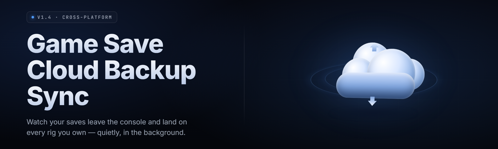

  
  
  

  

  
  
  

---

**Version 2.4.1** · Windows 10/11 x64 · Steam, Epic, GOG, emulator & manual saves

---

The **Game Save Cloud-Backup Sync Tool** is a tiny desktop `.exe` that watches your save folders, snapshots every change, and mirrors them to cloud storage you already own. It knows exactly where Steam, Epic, GOG, Ubisoft Connect, and 40+ emulators stash their saves — you point it at a provider, hit run, and every quicksave, every autosave, every 3 AM speedrun attempt is versioned and safe before you even alt-tab.

No launcher wrapper. No account. No telemetry. Drop the folder, run the `.exe`, done.

---

## 📥 Download

  

Extract the archive anywhere (Desktop is fine), run the `.exe`. First launch walks you through provider setup in under a minute. No installer, no dependencies, no admin rights required for default save paths.

---

## 📚 Table of Contents

- [Overview](#-overview)
- [What is Game Save Cloud-Backup Sync?](#-what-is-game-save-cloud-backup-sync)
- [Key Features](#-key-features)
- [The Problem](#-the-problem)
- [The Solution](#-the-solution)
- [Quick Start](#-quick-start)
- [Compatibility — Platform Support](#-compatibility--platform-support)
- [Comparison](#-comparison)
- [Installation](#-installation)
- [Cloud Provider Modules](#-cloud-provider-modules)
- [Save Detection & Game Modules](#-save-detection--game-modules)
- [Sync Engine Modules](#-sync-engine-modules)
- [Versioning & Restore Modules](#-versioning--restore-modules)
- [Conflict Resolution Modules](#-conflict-resolution-modules)
- [CLI & Automation Modules](#-cli--automation-modules)
- [System Requirements](#-system-requirements)
- [Usage Guidelines](#-usage-guidelines)
- [Known Issues](#-known-issues)
- [FAQ](#-faq)
- [Changelog — v2.4](#-changelog--v24)

---

## 🗂️ Overview

| Category | Details |
|---|---|
| Product type | Portable Windows desktop `.exe` (self-contained) |
| Primary job | Detect save folders → snapshot changes → sync to cloud → restore on demand |
| Supported stores | Steam, Epic, GOG Galaxy, Ubisoft Connect, EA App, Battle.net, Xbox app, itch.io |
| Emulator support | 42 emulators (RetroArch, Dolphin, PCSX2, Ryujinx, Yuzu-fork, PPSSPP, DuckStation, mGBA, more) |
| Cloud backends | Custom WebDAV, S3-compatible, Google Drive, Dropbox, OneDrive, Backblaze B2, local/NAS |
| Versioning | Per-save rolling snapshots with retention policy |
| Conflict handling | Timestamp + hash arbitration, manual pick, "keep both" branching |
| Runtime | .NET 8, ~38 MB unpacked, ~40 MB RAM idle |
| Config format | Human-readable `savesync.toml` — diffable, committable |

The tool is built around one idea: your saves are small, your patience is not. Every save file is hashed, timestamped, and stored as an immutable blob. Sync runs on a debounced filesystem watcher so a 60-save-per-minute speedrun session generates one upload, not sixty. Restore is a single click into any prior snapshot, and rollback never touches the live save folder until the write is confirmed atomic.

---

## 🎮 What is Game Save Cloud-Backup Sync?

| Term | Explanation |
|---|---|
| **Save root** | A folder the tool watches for file changes (e.g. `%APPDATA%\..\Local\GameName\Saves`) |
| **Snapshot** | An immutable, content-addressed copy of a save folder at a point in time |
| **Manifest** | A hash index mapping file paths → blob IDs for one snapshot |
| **Blob store** | The cloud/local destination where snapshot data lives (dedup'd, chunked) |
| **Sync job** | A rule binding one save root to one blob store with a schedule + retention policy |
| **Provider** | A backend adapter — WebDAV, S3, Drive, Dropbox, OneDrive, B2, local |
| **Conflict** | Same file changed locally and remotely since last sync; needs arbitration |
| **Retention policy** | Rules for how many/which snapshots survive garbage collection |

Why people run it:

- **Store-agnostic** — one tool for Steam, Epic, GOG, emulators, and hand-installed games.
- **Content-addressed dedup** — a 2 GB save folder that changes 1% per commit uploads 20 MB, not 2 GB.
- **Zero lock-in** — you bring your own cloud. Switch providers by editing one config line.
- **Offline-first** — syncs queue locally and flush when the network returns.
- **Restore without fear** — atomic writes, pre-restore backups, dry-run preview.
- **Runs quiet** — tray icon, no window unless you open one, ~0.1% CPU idle.

---

## ✨ Key Features

| Feature | Description | Benefit |
|---|---|---|
| Auto save-root detection | Scans known store manifests + Steam library VDFs | Zero manual path hunting for 90% of games |
| Debounced watcher | Coalesces rapid file writes into one snapshot | Speedrun-friendly, cheap uploads |
| Content-addressed blobs | Chunked, dedup'd, hash-named storage | Massive bandwidth + storage savings |
| Rolling snapshots | Configurable retention (`keep 20 hourly, 10 daily, 5 weekly`) | Never lose "the run before the crash" |
| Atomic restore | Writes to temp, fsync, rename-swap | No half-restored corrupt saves |
| Multi-provider | 7 backends, run several simultaneously | Redundant off-site copies, free |
| Conflict arbitration | mtime + size + hash, or manual pick | No silent overwrites, ever |
| Tray + CLI parity | Everything doable from GUI and `.exe` CLI | Scriptable + human-friendly |
| Config as code | `savesync.toml` is plain text | Commit it, version it, share it |
| Pre/post hooks | Run scripts before snapshot / after restore | Re-encrypt, strip junk, notify |
| Bandwidth cap | Token-bucket limiter | Doesn't nuke your game download |
| Portable mode | Everything in one folder, no registry | USB-stick friendly |

---

## 🩹 The Problem

- **Store saves are scattered.** Steam uses `userdata/<id>/<appid>/`, Epic buries saves in `%LOCALAPPDATA%`, GOG does its own thing, emulators each invent a folder.
- **Cloud sync tools fight your games.** Generic folder-sync (Dropbox/OneDrive) can lock files mid-write and corrupt saves.
- **No versioning.** Overwrite is forever if the game auto-saves over your 100% file.
- **Full re-uploads.** A 4 GB save folder changing one byte re-uploads the whole thing with naive sync.
- **Reinstall wipes progress.** Format-reinstall and your non-Steam-Cloud saves are gone.
- **Multi-machine drift.** Desktop save vs laptop save and no clear "which is newer."
- **Manual backup burnout.** Nobody zips their saves after every session. Nobody.

---

## 🛠️ The Solution

| Problem | Solution |
|---|---|
| Scattered save locations | Built-in store scanner + 40-game detection database + manual root add |
| Sync tools corrupting saves | Watcher waits for write quiescence, snapshots atomically |
| No versioning | Content-addressed snapshots with rolling retention |
| Full re-uploads | Chunk-level dedup — only changed chunks upload |
| Reinstall wipes progress | Restore any snapshot to any machine in one click |
| Multi-machine drift | Hash arbitration picks the true newest, or branches both |
| Manual backup burnout | Fully automatic background sync + tray notifications |

---

## 🏁 Quick Start

1. 🎯 **Download & extract.** Grab the archive, unzip it anywhere with write access.
2. ▶️ **Run the `.exe`.** First launch opens the setup wizard — no install step.
3. ☁️ **Add a provider.** Pick WebDAV / S3 / Drive / Dropbox / OneDrive / B2 / local-NAS. Paste credentials, test connection.
4. 🎮 **Detect your games.** Hit *Scan Libraries*. The tool finds Steam, Epic, GOG, and emulator save roots automatically.
5. 💾 **Start syncing.** Enable the tray watcher. Saves snapshot on change and flush to your cloud in the background.

Total time from unzip to first synced save: under two minutes on a warm machine.

---

## 🖥️ Compatibility — Platform Support

| Platform / Store | Detection | Sync | Restore | Notes |
|---|---|---|---|---|
| Steam | ✅ Auto | ✅ | ✅ | Reads `libraryfolders.vdf` + `userdata` |
| Epic Games | ✅ Auto | ✅ | ✅ | Handles per-title `%LOCALAPPDATA%` paths |
| GOG Galaxy | ✅ Auto | ✅ | ✅ | Cloud-save toggle respected |
| Ubisoft Connect | ✅ Auto | ✅ | ✅ | Some titles use cloud-only saves |
| EA App / Origin | ✅ Auto | ✅ | ✅ | Detects legacy Origin paths |
| Battle.net | ✅ Auto | ✅ | ✅ | Per-account subfolders |
| Xbox app (UWP) | ⚠️ Manual | ✅ | ⚠️ | UWP sandbox needs manual root |
| itch.io | ✅ Auto | ✅ | ✅ | Reads `.itch` manifests |
| RetroArch | ✅ Auto | ✅ | ✅ | SRM + state files |
| Dolphin | ✅ Auto | ✅ | ✅ | GC + Wii save dirs |
| PCSX2 / DuckStation | ✅ Auto | ✅ | ✅ | Memory cards + states |
| Ryujinx / PPSSPP / mGBA | ✅ Auto | ✅ | ✅ | Full state support |

---

## ⚖️ Comparison

| Aspect | Generic Folder Sync | Store Cloud Saves | This Tool |
|---|---|---|---|
| Save-aware detection | ❌ | ✅ but per-store | ✅ multi-store |
| File-lock safety | ⚠️ risky | ✅ | ✅ quiescence-wait |
| Versioning | ❌ overwrite | ⚠️ limited | ✅ rolling snapshots |
| Provider choice | Depends | Locked to store | ✅ 7+ backends |
| Bandwidth efficiency | Full re-upload | N/A | ✅ chunk dedup |
| Emulator support | ❌ | ❌ | ✅ 42 emulators |
| Scriptable / CLI | ⚠️ varies | ❌ | ✅ full CLI |
| Cost | Subscription | Free (store) | ✅ you own the cloud |

---

## 📦 Installation

1. **Extract the archive.** Right-click → *Extract All*. Put the folder somewhere it can stay (e.g. `C:\Tools\GameSaveSync`). Avoid `Program Files` unless you plan to run as admin — the tool writes config and cache next to the `.exe` in portable mode.

2. **Run the `.exe`.** No installer, no runtime to install — it's self-contained. Windows SmartScreen may warn on first run because the binary is new; *More info → Run anyway* clears it. Add your provider credentials in the wizard and let it scan libraries.

3. **Enable the tray watcher.** Right-click the tray icon → *Start watcher*. It'll register at startup (optional) and begin snapshotting on save changes. Configure retention and bandwidth caps in *Settings → Sync Engine*.

---

## ☁️ Cloud Provider Modules

**Provider Adapters** — each backend is a drop-in module with a shared interface.

| Feature | Effect |
|---|---|
| WebDAV adapter | Works with Nextcloud, Synology, any RFC-compliant server |
| S3-compatible adapter | AWS, MinIO, Wasabi, Backblaze B2 S3 endpoint |
| Google Drive adapter | Resumable uploads, folder-based blob layout |
| Dropbox adapter | Chunked session uploads for large saves |
| OneDrive adapter | Graph API, conflict-aware PUT |
| Local / NAS adapter | UNC paths, mapped drives, external SSD |
| Multi-destination | Fan-out a single snapshot to N providers |

**Transport Layer** — reliability under bad networks.

| Feature | Effect |
|---|---|
| Resumable uploads | Interrupted transfers resume, not restart |
| Retry with backoff | Exponential, jittered, provider-aware |
| Offline queue | Syncs persist locally until network returns |
| Bandwidth limiter | Token bucket, per-provider caps |
| Integrity check | Blob hash verified post-upload |

---

## 🕹️ Save Detection & Game Modules

**Library Scanners** — find the games before finding the saves.

| Feature | Effect |
|---|---|
| Steam VDF parser | Reads library folders + appmanifest files |
| Epic manifest reader | Parses `.item` manifests |
| GOG registry probe | Reads Galaxy-installed titles |
| Emulator config reader | Locates emulator save dirs from their settings |
| Manual root add | Drag-and-drop any folder as a save root |

**Save-Root Database** — a curated, community-updated file.

| Feature | Effect |
|---|---|
| Per-title path rules | 40+ built-in, extensible via TOML |
| Wildcard expansion | Handles `{UserID}`, `{SteamID}` placeholders |
| Multi-folder titles | Games with saves in two locations are grouped |
| Profile-aware | Per-account save subfolders handled |
| Community updates | Drop-in database file refreshed by the app |

---

## 🔄 Sync Engine Modules

**Watcher Core** — the debounce brain.

| Feature | Effect |
|---|---|
| Filesystem watcher | OS-native change notifications, low CPU |
| Debounce window | Configurable 2–30 s quiescence before snapshot |
| Exclusion filters | Skip `.tmp`, `.lock`, cache junk |
| Include filters | Whitelist by extension when needed |
| Multi-root jobs | One watcher per save root, isolated |

**Snapshot Builder** — turns a folder into an immutable record.

| Feature | Effect |
|---|---|
| Chunking | Fixed 512 KB content-defined chunks |
| Dedup | Identical chunks stored once across all snapshots |
| Manifest write | Hash index stored alongside blobs |
| Compression | Per-chunk zstd when beneficial |
| Encryption (opt) | AES-GCM before upload, key kept local |

---

## 🗄️ Versioning & Restore Modules

**Retention Engine** — keeps history sane.

| Feature | Effect |
|---|---|
| Rolling policies | e.g. keep 20 hourly / 10 daily / 5 weekly |
| Pinned snapshots | Mark "this is the 100% clear" — never GC'd |
| Named snapshots | Tag a restore point with a label |
| Dry-run GC | Preview what would be pruned |

**Restore Engine** — puts it back safely.

| Feature | Effect |
|---|---|
| Atomic write | Temp file → fsync → rename-swap |
| Pre-restore backup | Live save auto-snapshotted first |
| Selective restore | Restore one file, not the whole folder |
| Cross-machine restore | Pull any snapshot onto any machine |
| Dry-run preview | See the diff before applying |

---

## 🧩 Conflict Resolution Modules

**Arbitration** — decides who wins.

| Feature | Effect |
|---|---|
| mtime + size check | Fast pre-filter for "obviously newer" |
| Hash tiebreak | Identical timestamps resolved by content hash |
| Manual pick UI | Side-by-side diff, choose left/right |
| Keep-both branch | Store both versions, never silently lose one |
| Conflict log | Every arbitration written to a readable log |

**Safety Rails** — never eat a save.

| Feature | Effect |
|---|---|
| Write quiescence | Waits for game to stop writing |
| File-lock detection | Skips locked files, retries |
| Read-only guard | Never mutates source during snapshot |
| Integrity verify | Restored files hash-checked against manifest |

---

## ⌨️ CLI & Automation Modules

**`.exe` CLI** — every GUI action, scriptable.

| Feature | Effect |
|---|---|
| `snapshot <root>` | Force an immediate snapshot |
| `restore <snapshot> [--file x]` | Restore all or one file |
| `list <root>` | List snapshots with timestamps |
| `sync --provider b2` | Push to a named provider |
| `gc --dry-run` | Preview retention pruning |
| `verify <snapshot>` | Re-hash against manifest |
| `--config <path>` | Point at an alternate config |
| Exit codes | 0 ok, non-zero with reason for scripting |

**Hooks** — glue into your workflow.

| Feature | Effect |
|---|---|
| Pre-snapshot hook | Run before a snapshot is taken |
| Post-restore hook | Run after a restore completes |
| Shell-agnostic | Any `.cmd`, `.ps1`, `.exe` |
| Timeout guard | Hooks can't hang the engine |

---

## 🧾 System Requirements

| Component | Minimum | Recommended |
|---|---|---|
| OS | Windows 10 1809 x64 | Windows 11 23H2 x64 |
| CPU | Dual-core 1.8 GHz | Quad-core 2.5 GHz+ |
| RAM | 2 GB total | 8 GB total |
| Disk (tool) | 60 MB | 200 MB (log + cache headroom) |
| Disk (snapshots) | 2 GB local cache | 20 GB+ or cloud-only mode |
| Network | Any | 10 Mbps up for large saves |
| Runtime | None (self-contained) | None |
| Permissions | User-level for default paths | Admin only for protected save dirs |

---

## 📖 Usage Guidelines

| Allowed | Not allowed |
|---|---|
| Backing up your own game saves | Syncing saves you don't own |
| Restoring your own snapshots | Distributing copyrighted save data |
| Using any provider you have access to | Bypassing store DRM or auth |
| Scripting via the CLI for personal automation | Reselling the tool as a service without a license |
| Sharing your `savesync.toml` config | Sharing provider credentials in the config |

---

## 🧯 Known Issues

| Issue | Solution |
|---|---|
| Xbox/UWP saves not auto-detected | Add the UWP save root manually in *Settings → Roots* |
| SmartScreen warning on first run | *More info → Run anyway* until the binary is code-signed |
| Large first snapshot is slow | Expected — subsequent snapshots are incremental and fast |
| Provider rate limits during big syncs | Lower the bandwidth cap or enable multi-provider fan-out |
| Antivirus flags the watcher | Add an exclusion for the tool folder; it uses a standard FS watcher |

---

## ❔ FAQ

<b>Does this replace Steam Cloud?</b>

No — it complements it. Steam Cloud is per-store and locked in. This tool gives you provider-agnostic, versioned backups across every store and emulator at once. Run both; they don't conflict.

<b>Will it corrupt my saves if a game is writing?</b>

No. The watcher waits for a configurable quiescence window (default 5 s) after the last file change before snapshotting, and restore uses atomic temp-write-then-rename so a save folder is never left half-written.

<b>Do I need a subscription or account?</b>

No account, no subscription, no telemetry. You bring your own cloud provider — WebDAV, S3-compatible, Drive, Dropbox, OneDrive, B2, or a local/NAS path. If your provider has a free tier, the tool costs nothing to run.

<b>How much bandwidth does it actually use?</b>

Only changed chunks upload. A 2 GB save folder that changes 1% per commit typically uploads ~20 MB. With dedup and zstd compression, real-world traffic is often far lower.

<b>Can I run it on two machines and sync between them?</b>

Yes. Point both machines at the same provider. The tool arbitrates by timestamp and content hash, and offers a *keep both* branch so nothing is ever silently lost when both machines changed the same file.

**Q:** Does it work with emulators?
**A:** Yes — RetroArch, Dolphin, PCSX2, DuckStation, Ryujinx, PPSSPP, mGBA, and 35 more are in the detection database, covering both memory cards and savestates.

**Q:** Can I pin a snapshot so it never gets deleted?
**A:** Yes. Mark any snapshot as *pinned* or give it a name; the retention engine will skip pinned snapshots during garbage collection.

**Q:** Is there a portable mode?
**A:** Yes. Put a `portable.flag` file next to the `.exe` and all config, cache, and logs stay in the tool folder — nothing touches the registry.

**Q:** What happens if my cloud is offline?
**A:** Snapshots queue locally and flush automatically when the network returns. The offline queue is durable across restarts.

---

## 🧭 Changelog — v2.4

- **Added** S3-compatible adapter with Wasabi and MinIO endpoint presets.
- **Added** content-defined chunking for better dedup on large save folders.
- **Added** `--dry-run` to `gc` and `restore` for safe previews.
- **Improved** watcher debounce heuristics — fewer spurious snapshots during autosave storms.
- **Fixed** a race that could double-upload on flaky connections during resume.
- **Fixed** Xbox/UWP manual root not persisting across restarts.

---

## 📥 Download

  

---

Built for the people who lose a 200-hour save to one bad autosave. Point it at your cloud, let it run, and stop thinking about backups. Your saves are small, your time isn't — the tool trades the first for the second. Portable, provider-agnostic, no account, and every snapshot is one click from coming back.
